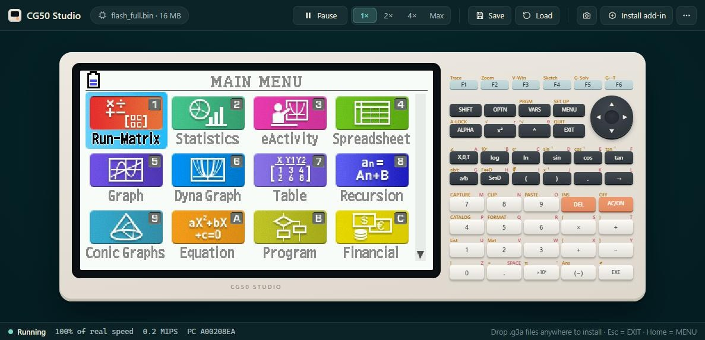

# CG50 Studio

A desktop app around the fx-CG50 emulator in [`../emu_go`](../emu_go): the real calculator OS
running in a window, for trying things out and developing add-ins. Windows, macOS and Linux,
built with [Wails](https://wails.io) (Go + the system's web view).



It ships no Casio software. You open a dump of your own calculator's flash (16 MB, or the
whole 32 MB, which brings your files and installed add-ins along with the storage memory).

## Running it

```sh
go install github.com/wailsapp/wails/v2/cmd/wails@latest   # once
python app/dev.py           # development: the window, plus http://localhost:34115 in a browser
python app/dev.py build     # app/build/bin/cg50studio(.exe)
python app/dev.py dev --hidden   # no window (test through the browser page); --min: minimized
python app/dev.py run --hidden   # the built app, same flags (the exe takes -hidden / -minimized)
```

On Linux with WebKitGTK 4.1 only (Ubuntu 24.04, Debian 13), add `-tags webkit2_41` to the
build. `dev.py` only runs the `wails` CLI from this folder. `wails dev` rebuilds when a `.go` file in
`app/` changes; after changing the core in `emu_go/`, touch a file here. `wails doctor` checks
the system (WebView2 on Windows, WebKitGTK on Linux).

## Releases

Pushing a tag `vX.Y.Z` runs [`.github/workflows/release.yml`](../.github/workflows/release.yml):
it builds the app on Linux (x86-64, WebKitGTK 4.1), Windows (x86-64) and macOS (universal,
ad-hoc signed, not notarized), and attaches `cg50-studio-X.Y.Z-<platform>.zip` to that tag's
release, creating it as a draft if it doesn't exist. The version comes from the tag (it sets
`wails.json`'s `productVersion` and `main.version`). The signed Android APK is added to the same
release by hand (see `android/README.md`). Run by hand, the workflow only builds.

On the first start the app shows a card asking for a flash dump (none is included), opens
the file dialog from there, and remembers the dump in `settings.json`; the dump button at the
top changes it. If the remembered file has moved, the card says so.

## What it does (milestone 1)

- **Screen and keypad**: the whole 396×224 panel, scaled to fit, at whole-pixel scales when
  it can (2× at the default window size); a clickable keypad laid out like the calculator's.
- **Keyboard**: held keys stay held (games work); letters type ALPHA + letter. The full map is
  under ⋯ → Keyboard shortcuts (and in `frontend/js/keys.js`).
- **Speed**: 1× is the real calculator's pace (about 45 million instructions a second), 2×,
  4×, and Max (as fast as the computer allows while the CPU works, never slower than 1×).
  The OS's clock follows the measured speed.
- **States**: Save/Load = quick slot 1 (Ctrl+S / Ctrl+L); Save state as… / Open state… use
  files that remember which dump they belong to. Closing the app saves where you were, and
  the next start resumes there (also autosaved every two minutes).
- **Add-ins**: Install add-in (or drop `.g3a` files on the window) writes them into the
  storage memory through the OS's own file calls, and they appear in the MAIN MENU.
- **Restart** (Ctrl+R) is the calculator's RESTART: storage memory kept, RAM lost. **Back to
  the dump as saved** forgets everything stored since.
- **Screenshots** at 1×, 2× or 3×, as PNG.

Files live in the user's config folder under `CG50 Studio/` (`%APPDATA%` on Windows,
`~/Library/Application Support` on macOS, `~/.config` on Linux): `settings.json`,
`layout.json` (the workspace), `sessions/<dump hash>.{state,slotN,breakpoints}` and
`analysis/<dump hash>.funcs` (the OS's function table, for a quick start).

## The workspace

Every window is a dock panel. Drag a tab onto another window to dock it beside it (left,
right, above, below) or into its tab group, or onto the edge of the workspace; drag the gaps
between windows to resize; the buttons on a group's tab bar float it above the others (and
dock it back) or maximise it. **Windows** (top bar) opens and closes windows, opens more
than one Memory or Disassembly view, and switches layouts:

- **Calculator**: the calculator alone, as the app looked before (the default; with one
  window there is no tab bar).
- **Debugging**: calculator, disassembly, registers, memory and trace, console, call stack
  and breakpoints.
- **Reverse engineering**: a big listing with syscalls and strings beside it, two memory views.
- **Reset layout** goes back to the default.

The layout, with each window's own view (address, followed register, search), is saved in
`layout.json` and comes back on the next start (in a browser without the Go side, in
`localStorage`).

Keys go to the window that has the focus, shown in the status bar when it isn't the
calculator: click the calculator and keys press calculator keys as before (Esc = EXIT, …);
in a listing they move around (F9 breakpoint, Enter follow, Backspace back, G go to, X who
refers to it); text fields keep theirs. Ctrl/⌘ shortcuts and the debugger keys (F8 run/pause, F11 step into, F10
step over, Shift+F11 step out, Ctrl+F10 run to the selected line) work everywhere. The
Calculator window shows the keypad when it fits at full size and only the screen otherwise
(the button in its corner: auto, always, never), at scales that stay on whole device pixels.

| Window | Shows |
|---|---|
| Calculator | the live screen and keypad |
| Disassembly | a whole address space at a time (the flash and its P2 mirror, the add-in at 0x00300000, RAM, the on-chip memories), with the OS's and the add-in's functions as labels, syscall and function names in operands and comments, literal values; the PC, breakpoints (F9, or click the left edge), branch targets to follow, back/forward, go to an address or a name, cross-references (X) |
| Memory (1, 2, …) | hex and text by region, go to, follow a register, bytes changed at the last stop, the selection as numbers; type hex digits to change a byte; device registers are shown as not read |
| Registers | general, control, the other bank, MACH/MACL, the DSP words; SR bits; changed values marked; double-click to change one |
| Breakpoints | execute (with a condition such as `r4 == 0x10 && pr > 0x80000000`, and a skip count), read/write watchpoints (every alias of the address), a syscall made by an add-in (or all), exceptions, interrupts; on/off, hits |
| Call stack | the frames rebuilt from PR and the stack at a stop, with names |
| Strings | ASCII, Casio and UTF-16 text in the OS, the storage memory, RAM or the add-in |
| Syscalls | the OS's own syscall table with the names known; double-click: the code; F9: break when an add-in calls it |
| Trace | the last instructions executed (while it records) |
| Console | the app's messages, every stop, and commands: `help` lists them (`c`, `s`, `n`, `finish`, `until`, `bp`, `bs`, `be`, `bi`, `bl`, `bd`, `r`, `set`, `x`, `w`, `bt`, `xref`, `info`, `trace`, `strings`, `sys`, `g`, `m`, `layout`) |

**Debugging.** Pause (F8) stops the machine between two instructions; so does a breakpoint, a
watchpoint, a syscall, exception or interrupt break, or the end of a step. The status bar and
the console say why, the disassembly marks the PC, and the windows show the state at the stop:
registers (changes since the last stop marked), call stack, memory read again, the trace.
Step into (F11), step over (F10), step out (Shift+F11) and run to the selected line (Ctrl+F10)
run on the machine itself; one that doesn't end at once (stepping over GetKey, which waits for a
key) keeps running at the chosen speed until it does. Run (F8) goes on from a stop. While it
runs, the registers and call stack stay, marked as from the last stop. The first stop in the
Calculator layout offers the Debugging layout. Breakpoints are kept per dump and set again on
every restart.

**The code analysis.** When a dump is opened the OS is analysed in the background (its 12,043
functions, then the cross-reference index; a few hundred ms) by
[`emu_go/sh4`](../emu_go/sh4); the status bar shows the progress, and the listing gets its
labels when it is done. The function table is cached per dump (96 KB of addresses and sizes,
nothing of the dump), so the next start skips the exploration. An installed add-in is analysed
from its `.g3a`; when the calculator launches an add-in, the one it runs is read through the
OS's add-in page table and analysed instead (a few ms).

Each window is a module in `frontend/js/panels/` with its interface at its top; `engine.js`
connects them to Go. The disassembly and the string search come from Go in batches of rows
(`paged.js`), never a call per row: 17 million rows of flash cost what is on screen. The
docking is [dockview](https://dockview.dev) (`dockview-core` 8.5.1, MIT, vendored in
`frontend/vendor/dockview/` with its licence; no build step, works offline), themed with the
colours below.

## How it fits together

| File | What |
|---|---|
| `main.go` | the window (`wails.Run`), the asset server and the `/frame` handler |
| `app.go` | everything the page calls (`window.go.main.App.*`), status events, files |
| `machine.go` | one running calculator and its run loop (wall-clock pacing, Max, boot boost) |
| `frame.go` | `/frame?since=<gen>`: the panel as raw RGBA, or 204 if unchanged; screenshots |
| `store.go` | settings, sessions, state files, dump checks |
| `layout.go` | the workspace layout (`LoadLayout` / `SaveLayout`, `layout.json`) |
| `debug.go` | the debugger's bindings: run control and stops, breakpoints (saved per dump), registers, memory, trace, call stack |
| `analysis.go` | the OS and add-in analyses (cached per dump), the listings, names, cross-references, syscalls, strings |
| `listing.go` | the disassembly's rows: which address each row shows, rendered in batches |
| `cond.go` | breakpoint conditions: expressions over the registers |
| `frontend/` | the page: plain HTML, CSS and JS modules, no build step |
| `frontend/js/workspace.js` | the dock: windows, presets, saving, the Windows menu, which window has the keys |
| `frontend/js/panels/` | one module per window; `vlist.js` is the virtual list they share |
| `frontend/js/debugger.js` | step actions and the breakpoint list, through a backend |
| `frontend/js/engine.js` | that backend: every window connected to Go, stops, the console's debugger commands |
| `frontend/js/paged.js` | rows that live in Go, fetched in blocks and cached |
| `build/` | icons and platform files (`make_icon.py` draws `appicon.png`) |

The page asks for `/frame` once per animation frame; an unchanged screen costs a 204. Key
events go to Go strictly in order (a fast tap's up could otherwise overtake its down), and the
core queues presses that would overlap so fast typing lands (`TestKeyBurstNoOverlap`).

## Design

Colours are defined once, as OKLCH tokens at the top of `frontend/css/app.css`, with the
reasoning in a comment there: a calm, low-chroma blue-green room (the hues people prefer most,
and low arousal for long sessions); the calculator as a warm porcelain object on it, so it's
the clear figure; warm ivory text instead of white; a single apricot accent for the primary
action; states that differ in hue and lightness (aqua running, amber paused, coral fault).
Change the tokens to retheme.

## Next

1. **Debugger**: peripherals (a side-effect-free view of device registers), profiling,
   symbols from an add-in's ELF, user labels and comments, watchpoint value conditions in the
   window (the core has them).
2. **Developer comforts**: reinstall when a `.g3a` is rebuilt, copy files out of the storage
   memory, GIF recording, a profiler, key scripts.
3. **In the browser**: the same page with the core compiled to WebAssembly, the dump kept
   only in the browser.

The app may move to its own repository later; `go.mod`'s `replace cg50emu => ../emu_go` is
the only tie to this one.
