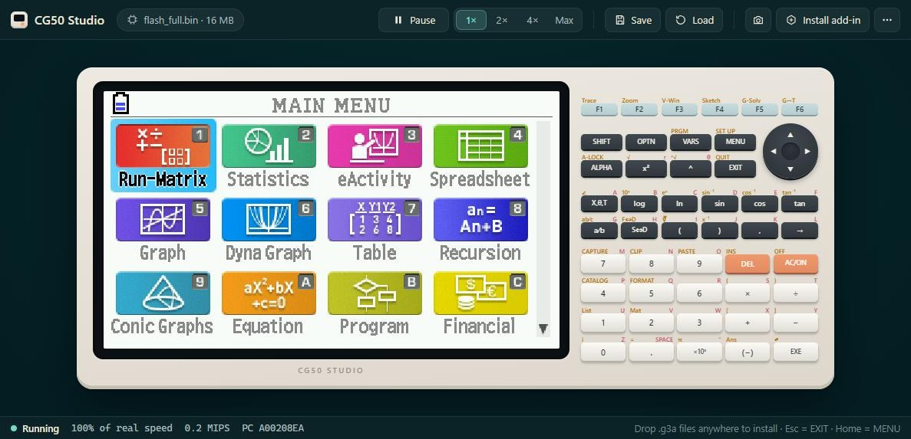

# CG50 Studio

A desktop app around the fx-CG50 emulator in [`../emu_go`](../emu_go): the real calculator OS
running in a window, for trying things out and developing add-ins. Windows, macOS and Linux,
built with [Wails](https://wails.io) (Go + the system's web view).



It ships no Casio software. You open a dump of your own calculator's flash (16 MB, or the
whole 32 MB with the storage memory, which is what installing add-ins needs).

## Running it

```sh
go install github.com/wailsapp/wails/v2/cmd/wails@latest   # once
python app/dev.py           # development: the window, plus http://localhost:34115 in a browser
python app/dev.py build     # app/build/bin/cg50studio(.exe)
python app/dev.py dev --hidden   # no window (test through the browser page); --min: minimized
python app/dev.py run --hidden   # the built app, same flags (the exe takes -hidden / -minimized)
```

`dev.py` only runs the `wails` CLI from this folder. `wails dev` rebuilds when a `.go` file in
`app/` changes; after changing the core in `emu_go/`, touch a file here. `wails doctor` checks
the system (WebView2 on Windows, WebKitGTK on Linux).

## What it does (milestone 1)

- **Screen and keypad**: the whole 396×224 panel, scaled to fit, at whole-pixel scales when
  it can (2× at the default window size); a clickable keypad laid out like the calculator's.
- **Keyboard**: held keys stay held (games work); letters type ALPHA + letter. The full map is
  under ⋯ → Keyboard shortcuts (and in `frontend/js/keys.js`).
- **Speed**: 1× is the real calculator's pace (about 45 million instructions a second), 2×,
  4×, and Max (as fast as the computer allows while the CPU works, never slower than 1×).
  The OS's clock follows the measured speed.
- **States**: Save/Load = quick slot 1 (Ctrl+S / Ctrl+L); Save state as… / Open state… use
  files that remember which dump they belong to. Closing the app saves where you were, and
  the next start resumes there (also autosaved every two minutes).
- **Add-ins**: Install add-in (or drop `.g3a` files on the window) writes them into the
  storage memory through the OS's own file calls, and they appear in the MAIN MENU.
- **Restart** (Ctrl+R) is the calculator's RESTART: storage memory kept, RAM lost. **Back to
  the dump as saved** forgets everything stored since.
- **Screenshots** at 1×, 2× or 3×, as PNG.

Files live in the user's config folder under `CG50 Studio/` (`%APPDATA%` on Windows,
`~/Library/Application Support` on macOS, `~/.config` on Linux): `settings.json` and
`sessions/<dump hash>.{state,slotN}`.

## How it fits together

| File | What |
|---|---|
| `main.go` | the window (`wails.Run`), the asset server and the `/frame` handler |
| `app.go` | everything the page calls (`window.go.main.App.*`), status events, files |
| `machine.go` | one running calculator and its run loop (wall-clock pacing, Max, boot boost) |
| `frame.go` | `/frame?since=<gen>`: the panel as raw RGBA, or 204 if unchanged; screenshots |
| `store.go` | settings, sessions, state files, dump checks |
| `frontend/` | the page: plain HTML, CSS and JS modules, no build step |
| `build/` | icons and platform files (`make_icon.py` draws `appicon.png`) |

The page asks for `/frame` once per animation frame; an unchanged screen costs a 204. Key
events go to Go strictly in order (a fast tap's up could otherwise overtake its down), and the
core queues presses that would overlap so fast typing lands (`TestKeyBurstNoOverlap`).

## Design

Colours are defined once, as OKLCH tokens at the top of `frontend/css/app.css`, with the
reasoning in a comment there: a calm, low-chroma blue-green room (the hues people prefer most,
and low arousal for long sessions); the calculator as a warm porcelain object on it, so it's
the clear figure; warm ivory text instead of white; a single apricot accent for the primary
action; states that differ in hue and lightness (aqua running, amber paused, coral fault).
Change the tokens to retheme.

## Next

1. **Debugger**: pause/step/step over/out, breakpoints and watchpoints, registers, a
   disassembly view with syscall names, a memory viewer/editor (needs a debug API in the core,
   with tests).
2. **Developer comforts**: reinstall when a `.g3a` is rebuilt, copy files out of the storage
   memory, GIF recording, a profiler, key scripts.
3. **In the browser**: the same page with the core compiled to WebAssembly, the dump kept
   only in the browser.

The app may move to its own repository later; `go.mod`'s `replace cg50emu => ../emu_go` is
the only tie to this one.
